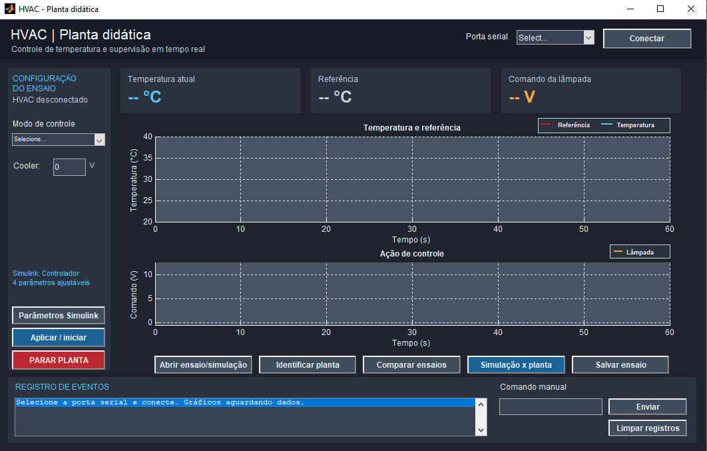
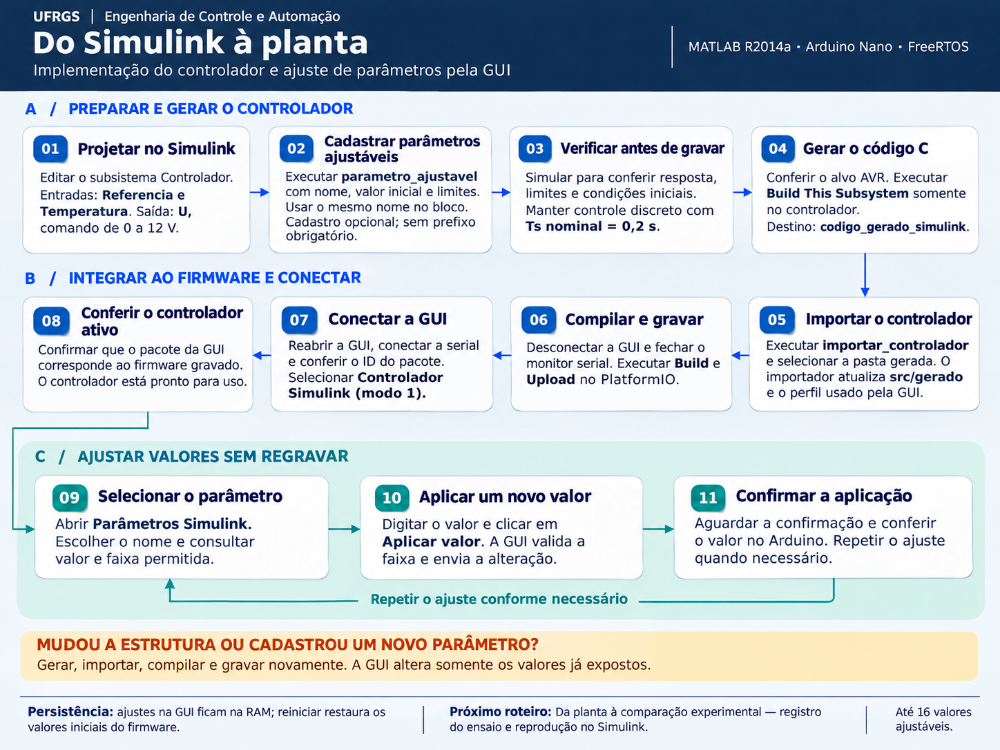
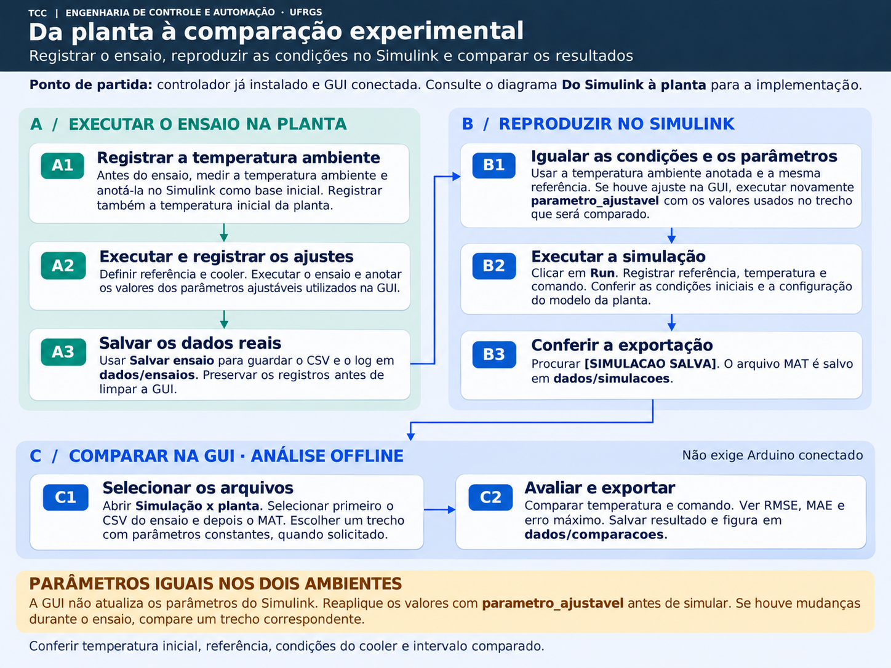

# Controle em tempo real com FreeRTOS e Simulink

Infraestrutura para projetar um controlador no **Simulink**, gerar o código C,
executá-lo em um **Arduino Nano com FreeRTOS** sobre uma planta térmica didática
(HVAC) e comparar o comportamento real com a simulação.

Trabalho de Conclusão de Curso em Engenharia de Controle e Automação — **UFRGS**
Autor: **Thiago Miorando Tavolara** · Orientação: **Prof. Marcelo Götz**



---

## O que dá para fazer

- **Projetar** a lei de controle no Simulink, dentro de um subsistema com entradas
  `Referencia` e `Temperatura` e saída `U` (0 a 12 V).
- **Gerar e importar** o controlador para o firmware sem escrever código C à mão.
- **Executar na planta** com período nominal de 0,2 s, sob escalonamento do FreeRTOS.
- **Ajustar parâmetros pela GUI** (até 16 valores) sem regravar o Arduino.
- **Registrar ensaios** em CSV e **comparar** com a simulação (RMSE, MAE e erro máximo).
- **Identificar** um modelo térmico da planta a partir de ensaios em malha aberta.

## Requisitos

| Item | Uso |
|---|---|
| MATLAB/Simulink **R2014a** | Modelagem, GUI e scripts |
| Simulink Coder + Embedded Coder | Geração de código (alvo `ert`) |
| Optimization Toolbox | Apenas para `identificar_planta_atraso` (`lsqnonlin`) |
| [PlatformIO](https://platformio.org/) (VS Code) | Compilação e gravação; baixa o FreeRTOS automaticamente |
| Bancada | Arduino Nano (ATmega328P), sensor SHT20, lâmpada e cooler acionados por PWM |

## Por onde começar

1. Abra o MATLAB na raiz do repositório e execute `configurar_pastas_simulink`.
2. Parta de um modelo em [`base_controladores_simulink/`](base_controladores_simulink):
   `simulink_base_PID.slx`, `simulink_base_Bang_Bang.slx` ou a base vazia `simulink_base_.slx`.
3. Cadastre os parâmetros ajustáveis com os exemplos de
   [`exemplos_preparar_parametros_controladores_simulink/`](exemplos_preparar_parametros_controladores_simulink)
   (`preparar_pid.m`, `preparar_bangbang.m`).
4. Siga os dois roteiros abaixo. O [guia visual em PDF](documentacao/Guia_Visual_Simulink_Arduino.pdf)
   traz as mesmas etapas com capturas de tela.

## 1. Do Simulink à planta

Gerar o controlador, integrá-lo ao firmware e ajustar valores pela GUI.



Em resumo:

```matlab
configurar_pastas_simulink        % destinos de geração e cache
preparar_pid                      % ou preparar_bangbang / seus parâmetros
% Simulink: Build This Subsystem no subsistema Controlador
importar_controlador              % atualiza src/gerado e perfil_controlador.txt
```

Depois, no PlatformIO: **Build** e **Upload**. Por fim, abra a supervisão com
`HVAC_TCC_GUI` (pasta `GUI/`).

## 2. Da planta à comparação experimental

Registrar o ensaio, reproduzir as mesmas condições no Simulink e comparar.



## Organização dos arquivos

| Caminho | Conteúdo |
|---|---|
| `src/` | Firmware: tarefas FreeRTOS, comunicação serial, proteções e ponte com o controlador |
| `src/gerado/` | Controlador gerado pelo Simulink e integrado por `importar_controlador` |
| `GUI/` | `HVAC_TCC_GUI.m`, interface de supervisão e comparação |
| `base_controladores_simulink/` | Modelos-base (vazio, PID e liga-desliga) com a planta e os registros |
| `exemplos_preparar_parametros_controladores_simulink/` | Cadastro dos parâmetros ajustáveis dos exemplos |
| `*.m` (raiz) | Importação, cadastro de parâmetros, identificação, registro e comparação |
| `perfil_controlador.txt`, `registro_parametros.mat` | Identificação do pacote instalado e cadastro dos parâmetros |
| `dados/` | Ensaios, identificações, simulações e comparações |
| `documentacao/` | Diagramas e guia visual |
| `platformio.ini` | Placa, plataforma e dependências do firmware |

Pastas recriadas automaticamente e fora do Git: `codigo_gerado_simulink/`,
`cache_simulink/` e `.pio/`.

## Ensaios do TCC

Os dados apresentados no trabalho estão em
[`dados/ensaios/ensaios_tcc/`](dados/ensaios/ensaios_tcc). Cada pasta de ensaio
contém o CSV e o log da planta, o MAT da simulação, o MAT e a figura da comparação,
e um `DADOS.txt` com as condições do ensaio.

| Pasta | Controlador | Referência | Parâmetros | T inicial |
|---|---|---|---|---|
| `1_PID_referencia_28C` | PID | 28 °C | P = 4, I = 1, D = 0,2, N = 5 | 24,80 °C |
| `2_PID_referencia_30C` | PID | 30 °C | P = 4, I = 1, D = 0,2, N = 5 | 23,46 °C |
| `3_PID_outra_sintonia_30C` | PID | 30 °C | P = 3, I = 1, D = 0,2, N = 5 | 26,07 °C |
| `4_bangbang_referencia_30C` | Liga-desliga | 30 °C | histerese ±0,5 °C, saída 0 / 12 V | 25,20 °C |

Todos com período de 0,2 s e cooler desligado. Os ensaios de identificação
(malha aberta) usados no ajuste do modelo da planta são
`identificacao_01_degrau_0p5V_cooler0.csv` e `identificacao_multinivel_02.csv`,
na mesma pasta.

O controlador presente em `src/gerado/` é o **PID** (pacote `42e6c08e5a7c665d`).
Para executar o liga-desliga, gere e importe o modelo `simulink_base_Bang_Bang.slx`.

## Autoria e créditos

- **Implementação deste trabalho:** firmware em `src/` (exceto `src/gerado/`), GUI,
  scripts MATLAB, modelos-base, diagramas e guia — Thiago Miorando Tavolara.
- **Código gerado:** os arquivos de `src/gerado/` são produzidos pelo Simulink
  Coder/Embedded Coder a partir dos modelos deste repositório; `rtwtypes.h` e
  `rtmodel.h` seguem o formato da MathWorks.
- **Bibliotecas de terceiros** (não incluídas; baixadas pelo PlatformIO):
  [FreeRTOS para AVR](https://github.com/feilipu/Arduino_FreeRTOS_Library)
  (`feilipu/FreeRTOS@11.1.0-3`, licença MIT) e o framework Arduino (`atmelavr@5.3.0`).
- MATLAB e Simulink são marcas registradas da The MathWorks, Inc.
